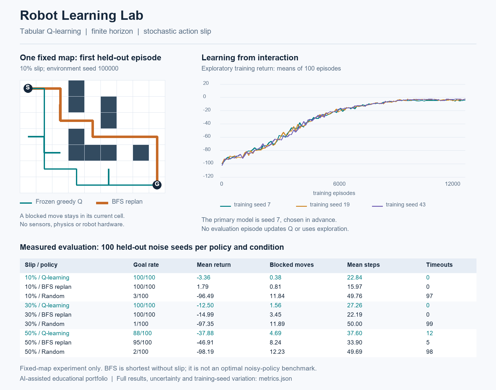

# Robot Learning Lab

**Can a robot-like grid agent learn to reach a goal when its movement commands sometimes slip sideways?** This small reinforcement-learning experiment learns a Q table from interaction, compares it with random actions and a BFS planning reference, and reports the failures as well as the successes.

The implementation uses NumPy, a discrete obstacle map and a finite episode horizon. There are no pretrained weights, hard-coded learned routes, external datasets, robot hardware, ROS, sensors or physics.



## Run it

Use Python 3.10 or newer. From the project directory:

```bash
python -m venv .venv
```

Activate with `.venv\Scripts\activate` on Windows or `source .venv/bin/activate` on macOS/Linux, then:

```bash
python -m pip install -r requirements.txt
python -m unittest -v
python demo.py
```

The recorded run used Python **3.12.14**, NumPy **2.3.5** and Pillow **12.3.0**. The full demo trains three models with 12,000 episodes each; the recorded run took about 22 seconds, which is a machine-specific observation rather than a benchmark. Its default output directory is the directory containing `demo.py`.

`python demo.py --episodes 3000 --output-dir experiments/short-run` makes a separate, shorter experiment. Different episode counts can produce weaker results; they should not be compared with the recorded table as if the training were identical.

## Environment and state

The **same 9 × 7 map**, start, goal and rewards are used in training and testing. Only the episode random-number seeds are held out. This demonstrates stochastic performance on one known map, **not generalization to unseen maps**.

```text
S..#.....
...#.#...
.....#...
...#.....
...###.#.
.........
........G
```

`S = (0, 0)`, `G = (8, 6)`; x increases rightwards and y downwards. `#` cells cannot be occupied. The deterministic four-connected shortest route has **14 moves**. The agent is a grid cell, not a circular/rectangular physical footprint.

The observation is **(position, remaining steps)**, with 50 steps initially. Including time remaining makes the finite-horizon problem Markovian instead of silently treating timeout as an unexplained stationary terminal state. The Q-table shape is `(51, 7, 9, 4)`; index zero is the zero-remaining-time boundary.

Actions are up, right, down and left. For slip probability `p`, the requested action executes with probability `1-p`; its left and right perpendicular actions each execute with probability `p/2`. A single uniform environment draw is consumed on every step. Position feedback is exact.

| Event | State change | Reward | Episode status |
|---|---|---:|---|
| Ordinary free-cell move | Move to actual destination | −1 | Continue if time remains |
| Obstacle or boundary hit | Stay at the current cell | −5 | Continue if time remains |
| Reach goal | Move to goal | +20, replacing the step cost | Terminated |
| Final step without reaching goal | Apply the ordinary/collision transition | −1 or −5 | Truncated at 50 steps |

Reaching the goal on the final step counts as termination, not truncation. Completed episodes cannot be stepped again. Starting at the goal yields success with zero actions and zero reward. Here, a “collision” means a **blocked move attempt**; the agent never enters an obstacle cell. This is not a real-world collision-safety system.

## What is learned

For every transition, the selected state-action value is updated:

```text
target = reward                                  if terminated or truncated
target = reward + gamma * max(Q[next_state, :])   otherwise
Q[state, action] += alpha * (target - Q[state, action])
```

All Q values start at zero. The learning rate is `alpha = 0.25`; the discount is `gamma = 0.97`. Epsilon-greedy exploration begins at 0.90, decreases linearly toward 0.05 over the first 80% of training, and remains at 0.05. Training breaks equal-value action ties randomly. The nominal training slip is 0.10.

The primary run uses training seed **7**, selected before evaluation. Seeds **19** and **43** provide a small variation check, not a search for a winning seed. Each gets 12,000 episodes. Environment training seeds follow `20,000,000 + training_seed × 1,000,000 + episode_index`, which keeps all these episodes separate from the declared evaluation seeds.

The original Q-learning paper is [Watkins and Dayan (1992)](https://doi.org/10.1007/BF00992698), also available in an [author-hosted copy](https://www.gatsby.ucl.ac.uk/~dayan/papers/cjch.pdf). This finite experiment uses a fixed learning rate and limited exploration; it does **not** claim asymptotic convergence or an optimal learned policy.

## Fair evaluation and baselines

Every policy is evaluated for **100 episodes** using seeds `100000…100099`, on the same map and 50-step horizon. Those seeds are never used during training. Each policy and slip condition receives the same per-episode uniform noise stream; the random baseline uses a separate stream for its action choices. Shared noise supports paired comparisons, although different paths naturally produce different outcomes.

- **Frozen Q policy:** deterministic argmax, epsilon zero, no updates. Evaluation passes a read-only table view and verifies an unchanged snapshot afterward.
- **Random policy:** each requested action is uniformly sampled from all four actions; blocked actions are possible.
- **BFS replanning:** recomputes a deterministic shortest path from the actual observed cell at each step. It knows the obstacle map, but **ignores the slip probabilities and reward function**. It is optimal for the deterministic unweighted graph; it is not an optimal stochastic-control benchmark.

The 0% test checks the deterministic reference. The 30% and 50% tests change slip only, without retraining. Reported returns are **undiscounted reward sums**; the training target uses a discount. These are different quantities and are labelled separately.

## Actual results

These are generated results from the included code, not targets typed into the simulator. Mean steps and mean returns include unsuccessful 50-step episodes.

| Slip | Policy | Goals / 100 | Mean return | Mean steps | Mean blocked attempts | Timeouts |
|---|---|---:|---:|---:|---:|---:|
| 0% | Q-learning | 100 | −1.00 | 22.00 | 0.00 | 0 |
| 0% | BFS replanning | 100 | 7.00 | 14.00 | 0.00 | 0 |
| 0% | Random | 2 | −98.85 | 49.95 | 12.33 | 98 |
| 10% | Q-learning | 100 | −3.36 | 22.84 | 0.38 | 0 |
| 10% | BFS replanning | 100 | 1.79 | 15.97 | 0.81 | 0 |
| 10% | Random | 3 | −96.49 | 49.76 | 11.84 | 97 |
| 30% | Q-learning | 100 | −12.50 | 27.26 | 1.56 | 0 |
| 30% | BFS replanning | 100 | −14.99 | 22.19 | 3.45 | 0 |
| 30% | Random | 1 | −97.35 | 50.00 | 11.89 | 99 |
| 50% | Q-learning | 88 | −37.88 | 37.60 | 4.69 | 12 |
| 50% | BFS replanning | 95 | −46.91 | 33.90 | 8.24 | 5 |
| 50% | Random | 2 | −98.19 | 49.69 | 12.23 | 98 |

The Q agent learns a useful policy compared with random actions, but **does not learn the shortest route**: it takes 22 moves without slip, versus BFS's 14. Under nominal noise, BFS also has the better mean return. At 50% slip, the Q agent has a better mean return but reaches fewer goals than BFS. The collision penalty can reward a cautious detour without maximizing the probability of finishing by the deadline. None of these outcomes is hidden or described as a universal improvement.

For the primary Q policy, a 100/100 success result has a 95% Wilson interval of approximately **96.3–100%**; it is not proof of guaranteed success. At 50% slip, 88/100 gives approximately **80.2–93.0%**. These intervals describe repeated episodes with a fixed policy, not training-seed uncertainty.

### Training variation

| Training seed | 10% slip: goals / 100 | 10% slip: mean return | 50% slip: goals / 100 | 50% slip: mean return |
|---|---:|---:|---:|---:|
| 7, primary | 100 | −3.36 | 88 | −37.88 |
| 19 | 100 | −2.71 | 87 | −39.77 |
| 43 | 100 | −1.86 | 88 | −36.52 |

The primary exploratory training return improves from **−100.14** in the first 100 episodes to **−4.18** in the final 100. The figure shows block means for all three training seeds. These curves combine learning with a changing exploration rate; they are not greedy test scores.

The map illustration uses **the first held-out episode**, not a hand-picked success. Branches in a trajectory can represent backtracking after a slip. All per-episode outcomes, frozen-table checks, parameters, confidence intervals, versions and seed variation are in [metrics.json](metrics.json). There is no independent external benchmark or claim that the inspected test conditions should now be reused for future tuning.

## Files and verification

| File | Purpose |
|---|---|
| `learning.py` | Environment, BFS, finite-horizon Q-learning and frozen evaluation |
| `demo.py` | Reproducible three-seed experiment and figure generation |
| `test_learning.py` | 12 meaningful behaviour and isolation tests |
| `metrics.json` | Actual evaluation results, seeds and experiment configuration |
| `training_history.csv` | 100-episode training summaries for all three seeds |
| `q_table.npz` | Learned primary table plus map/horizon metadata |
| `demo.png`, `demo.svg` | Raster and vector versions of the same measured figure |
| `MODEL_CARD.md` | Intended scope, evidence and limitations |

All 12 local tests pass. They cover collision/reset semantics, goal versus timeout, invalid actions, disconnected maps, deterministic shortest paths, terminal bootstrapping, actual learning on a small problem, seeded repeatability, frozen evaluation and Q-shape validation. The full experiment was executed and the PNG visually inspected. Local verification does not imply a GitHub CI run has succeeded.

Load the saved numeric table without pickle:

```python
import numpy as np
from learning import demo_grid, evaluate

with np.load("q_table.npz", allow_pickle=False) as saved:
    q = saved["q_table"].copy()
result = evaluate(demo_grid(), "q_learning", range(100000, 100100), q, slip=0.1)
print(result["success_rate"], result["mean_return"])
```

## Limits and useful next experiments

This tiny environment has perfect position feedback, static known obstacles, one start/goal and no physical dynamics. A table cannot transfer to a different state space without a new representation/training setup. The finite training budget and fixed learning rate leave a visibly suboptimal policy. Three training seeds are only a small stability check, and the 100 evaluation episodes per condition are shared across policies, so outcomes are paired rather than separate independent samples between policies.

To extend it honestly, freeze a new experiment plan, reserve fresh evaluation seeds, compare a decaying learning rate, or use value iteration as a stochastic planning reference. New maps require a clearly specified training/evaluation design. Real robotics would additionally need state estimation, dynamics, safety controls and hardware validation; none is implemented here.

## Interview questions and provenance

Before presenting this project, reproduce it and explain:

1. Why are remaining steps part of the state, and why are timeout targets not bootstrapped?
2. How do intended and actual actions differ, and what does a blocked move do?
3. Why can Q-learning score a better return while reaching fewer goals?
4. Why is BFS shortest without slip but not an optimal noisy policy?
5. What exactly is held out, and why does it not establish unseen-map generalization?
6. Why is 100/100 not a success guarantee, and what uncertainty is missing from that interval?
7. How do exploration decay and learning both affect the training curve?

This is an **AI-assisted educational portfolio project prepared for Nishanth Senthil Kumar**. The initial implementation, tests, documentation and figures were prepared with AI assistance and executed locally. A repository is evidence of a reproducible experiment; it is not evidence that its owner independently implemented or has mastered every component. Review the code, run it and document your own changes before claiming personal engineering contributions. It must not be presented as professional delivery, ROS integration or hardware experience.

MIT licensed; there is no external dataset or pretrained model.
